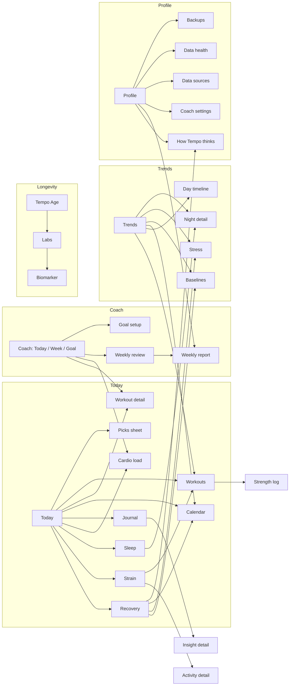
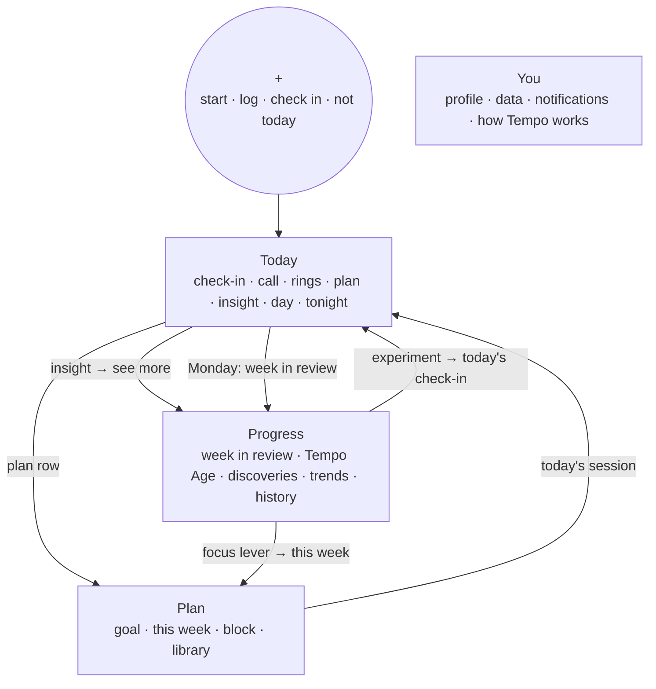
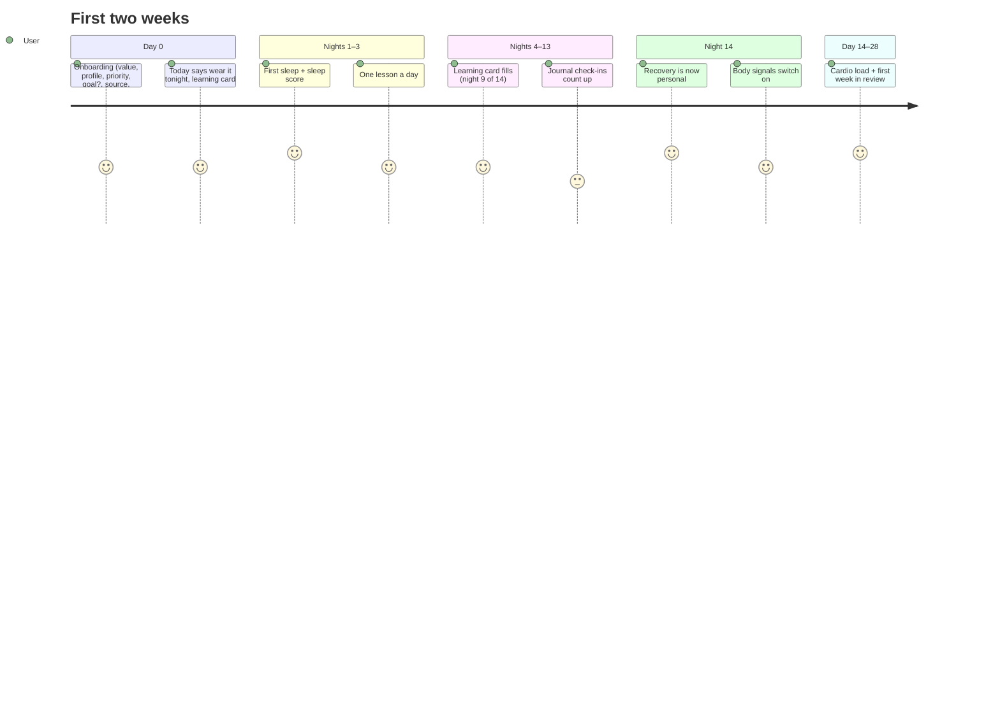

# User flow and journey

As of Oct 21, 2026 · Built as F1 (PLAN.md); the decisions are in `docs/decisions.md` (2026-10-21). Mock-ups: claude.ai artifact `3UEgT7p95NrLJxX5REjemB`.

What differs from this proposal as built: pause offers ill and travelling (no injured); there is no "add an activity" in the start sheet (Tempo has no manual entry yet); heart-rate recovery shows in the after-session recap but isn't an insight trigger; customisable Today and the onboarding goal step are left for later (onboarding points to Plan → Goal).

The question: Tempo has grown phase by phase (C0–C7, P1–P2, N1, H0–H4, E1, T1), and from the user's side it now feels scattered. Things are hard to find, insights we already compute go unseen, and there is no path through the app. This doc audits the app as it is, looks at who uses it and at what the leading apps do, then proposes one structure and one daily, weekly and long-term journey.

Method: a walk through every screen and every `push`/`present` in `app/lib/src` (42 screens), the onboarding and notification paths, and desk research. That means published studies on why people stop using trackers and on tracking anxiety, plus the 2025–26 redesigns of the leading strap, ring, big-tech tracker and sports-watch apps, read through their announcements and reviews. Competitor names stay out of the repo (decision 2026-10-16). No user interviews were run. §13 says how to test this with real people before building it all.

## Summary

1. **There is no spine.** Five tabs split the app by feature (Coach, Trends, Longevity), not by the questions people ask ("What do I do today?", "How did my week go?", "Am I getting healthier?"). Today and Coach → Today both answer the daily question, with two different text functions that can disagree.
2. **Most of the good insight sits two or three taps deep, behind a score.** Sleep regularity, social jetlag, brisk minutes, still stretches, heart-rate recovery, feel vs recovery, journal impacts, baselines, the smart alarm and the weekly report are each shown on exactly one detail screen. The weekly report and "How Tempo thinks" sit under Profile, among the settings.
3. **Time of day doesn't change anything.** Today looks the same at 7:00 and at 22:00. The evening (tonight's need, bedtime, smart alarm) lives inside Sleep detail.
4. **No rituals beyond the morning.** The week has two half-artefacts (Weekly review under Coach → Week, Weekly report under Profile) and no regular moment. Tempo Age updates weekly but nothing brings you to it.
5. **The proposal:** four tabs plus a centre action. **Today** (the day as a story: morning brief → day → evening wind-down, with one voice and one daily insight), **Plan** (this week and the goal), **Progress** (the week in review, trends, Tempo Age and discoveries, so "am I getting better?" has one home), **You** (profile, data, settings). Centre button: **Start / Log**.
6. **Connect every number to a why and a next step.** Each insight card ends in one action that lands somewhere real: set a bedtime nudge, see the week, start an experiment, log a lift.
7. **One ritual per horizon:** a 20-second morning check-in and call, a glance during the day, an evening wind-down, a Monday week review (which also carries the weekly Tempo Age update), and the goal block.
8. **Order of work:** F0 quick fixes (one voice, stale copy, dead screen) → F1 Today as a story → F2 tabs and Progress → F3 weekly ritual → F4 insight ranker and the first 14 days. Each step ships alone and has its own gate.

## 1 · The app as it is

### Tabs and what hangs off them



42 screens. The day's numbers branch out into nine detail screens. Nothing leads back from a detail to an action, except "See full breakdown" from the why sheet.

### Where each insight lives today

Taps are counted from launch, on the shortest path. "Scroll" means below the first screen.

| Insight (already computed) | Only shown on | Path | Seen by a typical user? |
| --- | --- | --- | --- |
| Sleep regularity, social jetlag (E1) | Sleep detail, `RhythmCard` | Today → Last night → scroll to the end | Rarely |
| Brisk minutes, longest still stretch (E1) | Strain detail, `MovementCard` (+ a Trends card) | Today → Strain ring → scroll | Rarely |
| Heart-rate recovery after a workout (E1) | Activity detail, `RecoveryHrCard` | Today → Strain → activity row → scroll | Almost never |
| Feel vs recovery | Recovery detail, `FeelVsRecoveryCard` | Today → Recovery → scroll | Rarely |
| Body signals, full list | Recovery detail | Today → Recovery (alert only when several are off) | Only on bad days |
| Journal impact % and experiments (T1) | Journal | Today → journal icon → scroll; locked until 14 check-ins | Only by journal users |
| Baselines | Baselines | Trends → chip | Rarely |
| Tonight's need, bedtime, smart alarm | Sleep detail, "Tonight" | Today → Last night → scroll | Rarely, and at the wrong time of day |
| Weekly report + share card | Weekly report | Profile → Weekly report, or Coach → Week → Your week so far → report | Almost never |
| How the scores work | Learn | Profile → How Tempo thinks, or "?" on a detail | Rarely |
| Strength log, muscle freshness (T1) | Workouts, picks, live workout | Trends → Workouts → Log a strength session | Only by lifters who go looking |
| Tempo Age change, focus lever | Longevity tab | 1 tap, but nothing points there | Weekly at best |
| Day timeline | Day timeline | Trends → chip, or Calendar → day | Rarely |
| Pause (sick, injured, travel) | Profile → Pause | 2 taps, in Settings | Only if they know it exists |

### What a person sees on Today right now

From `screens/today.dart`, in order: date + journal icon + calendar icon + sync pill → sync progress → at most one banner → body-signals alert → feel card (mornings) → coach line → rings → plan card, rest card or done card → goal line → picks entry → journal nudge → first-week card → week bars → zone donut + load gauge → last night strip → today's workouts.

That is up to 15 blocks and three charts. The decision ("what do I do?") sits under the rings, and the evening needs aren't there.

## 2 · Problems, from the user's side

| # | Problem | Evidence |
| --- | --- | --- |
| 1 | **Two voices for one question.** Today's line and Coach's readiness line are separate functions, and they can contradict each other. | `screens/shared.dart:278` `coachLine` vs `screens/coach.dart:291` `_readiness`. With recovery 72 % and the night-HR illness flag, `readiness()` makes the day Rest. Coach then says "Take it easy… rest today", while Today says "Recovery 72 % — you're primed… aim for 13–16 strain", and the strain target ignores the state. |
| 2 | **A wrong reason on Ease-off days.** Coach says "last night was short" whenever resting HR isn't high. But Ease off also comes from a hard session within 48 h or an overreaching load (`dayState`). | `screens/coach.dart:331–334`, `packages/scoring/lib/src/coach.dart:852` |
| 3 | **The day is duplicated across tabs.** The plan card and picks appear on Today and again on Coach → Today, so it isn't clear which one is "the" place. | `today.dart` `WorkoutCard` + `PicksEntry`; `coach.dart` `WorkoutCard` + `TodayPicks` |
| 4 | **Tabs follow features, not questions.** Longevity gets a whole tab, while the week review is two levels deep and the weekly report is under Profile. | `app.dart` `_tabs`; `settings.dart:856` |
| 5 | **Insights are buried** (table above). People only see them by tapping a score and scrolling to the end of a detail screen. | §1 |
| 6 | **No sense of time.** Today doesn't change between morning and night, and the evening lives in Sleep detail. | `today.dart` (only the feel card depends on the hour) |
| 7 | **No weekly moment.** The weekly notification opens Weekly review, and the report is a separate screen. Tempo Age moves weekly with nothing to tie it to. | `app.dart:232`, `weekly_review.dart:184` |
| 8 | **Onboarding ends at a blank Today.** It asks for a priority, but setting a goal is left for "later on Weekly plan", a screen that is no longer reachable. The first-week card is a static checklist. | `onboarding.dart:567`; `WeeklyPlanScreen` is never pushed; `today.dart` `FirstWeekCard` |
| 9 | **The first two to four weeks unlock silently.** Personal recovery comes at night 14, body signals at 14 nights, cardio load at 14 worn days, journal insights at 14 check-ins. None of this is shown as progress. | `signalMinNights`, `loadMinDays`, `journalInsightsAt` |
| 10 | **The words assume an athlete.** Strain 0–21, cardio load, Z2, TRIMP, "stress index ≈ proxy" greet everyone, including people whose priority is wellbeing. | onboarding `Goal.wellbeing` changes the plan, not the language |
| 11 | **Profile mixes content and settings.** Learn, the weekly report, Coach settings and Pause sit among the units and backups. | `settings.dart` |
| 12 | **Logging is hard to find.** The start button offers sports but not "log a lift", "add a workout" or "check in". | `nav.dart` `pickWorkout` |

## 3 · Who uses Tempo

Three people, plus two states that any of them can be in.

| | **The everyday mover** | **The training athlete** | **The optimiser** |
| --- | --- | --- | --- |
| Example | 41, office job, Health Connect + a cheap watch, priority *wellbeing* | 29, half marathon in 10 weeks, Mi Band, priority *performance* | 35, loves data, logs lifts and caffeine, reads about longevity |
| Main question | "Am I OK? What's one thing to do?" | "Can I push today? Am I on track for race day?" | "What actually moves my numbers?" |
| Time in app | 20 s in the morning, a glance in the evening | 1–2 min in the morning, after each session, Sunday/Monday | Several visits a day, a longer look weekly |
| Needs | Plain words, reassurance, small wins, no guilt | Plan, readiness, load, goal progress, adapting | Causes, experiments, trends, Tempo Age levers |
| Turned off by | Jargon, red numbers, charts first | Generic advice, a plan that ignores what they did | Hidden data, no way to test a hunch |

States: **the newcomer** (first 14–28 days, nothing personal yet) and **the off week** (ill, travelling, injured, or back after a break).

### Moments of use (jobs to be done)

| Moment | Job | Today's answer | Gap |
| --- | --- | --- | --- |
| Wake | "How did I sleep, how am I, what's the plan?" | Notification → Today | Two voices; the feel card and the journal are separate cards |
| Before training | "What exactly do I do?" | Plan card → Workout detail → Start | Fine. Picks are a separate row |
| During the day | "Am I on track? Am I too still?" | Rings | Brisk minutes, still stretches and steps are hidden in Strain |
| After training | "How did that go?" | Live summary + RPE | Heart-rate recovery and strain added are hard to find afterwards |
| Evening | "When should I sleep? Wind down" | Bedtime nudge notification | Nothing on Today |
| Monday | "How did my week go, what's next?" | Weekly review (deep), report (Profile) | No single ritual |
| Monthly+ | "Am I fitter, healthier, younger?" | Trends tab, Longevity tab | Split over two tabs, with no story |
| Curious | "Why is this number low? What affects me?" | Why sheet, detail screens, journal | No link from a finding to doing something |

## 4 · What the leading apps do

Each pattern is named by the app it comes from, kept generic. What to take, and what to avoid.

| App | What changed in 2025–26 | Take | Avoid |
| --- | --- | --- | --- |
| **The leading strap** | Home rebuilt around three dials at the top (sleep, recovery, strain), each with its own deep dive. A new **Health** tab gathers cardiovascular fitness and healthspan. A more prominent central **action button**. A morning **daily outlook** opened from Home. A **weekly plan** that turns the weekly age update into daily targets. | Scores on top, deep dives behind them. One long-term tab. A central action. Weekly age → this week's actions. | AI briefs that feel templated and ignore stated preferences are its users' top complaint |
| **The ring** | Five tabs (home, readiness, sleep, activity, resilience) cut to **three: Today, Vitals, My Health**. Today works like a news app's "top stories". A **daily highlight** that changes with the time of day. A **timeline** of the day that shows how choices moved the data. | Tabs by time horizon (day → vitals over time → long-term health). One highlight a day. Today changing through the day. | — |
| **The big-tech tracker** | Bottom bar now **Today, Fitness, Sleep, Health**. Four **customisable** focus metrics on Today. Coach on the floating button. Daily goals replaced by a **weekly cardio target**. | A weekly target over daily pass/fail. Let people choose what they see on Today. | Coach locked behind a subscription |
| **The sports-watch app** | A **morning report** on waking: sleep, HRV status, training readiness, training status, the day's suggested workout, weather. Today built from widgets, with upcoming workouts and events. | A morning report that leads to the suggested session. Upcoming plan on Today. | A widget wall with no order |
| **The gentle-fitness app** | A personal **activity path** instead of fixed rings. Status can be set to **sick, injured or on a break**. Ranked suggestions where **rest can be first**. | Range, not pass/fail. A one-tap "not today" status. Rest as a valid suggestion. | — |
| **The Health-based readiness app** | Recovery + an exertion target from recovery. A wide set of home-screen and lock-screen widgets. | Glanceable widgets as the day-time surface (Tempo has these already). | — |
| **The benchmark Health app** | See `Competitor teardown and next steps.md`: grouped biological age with confidence, a journal with impact %, strength logging. | Already built in T1. Now it needs surfacing. | One overly precise number |

Two lessons hold across all of them. **They cut the number of tabs and organise them by time horizon.** And **they put one readable message first, with the numbers beneath it.**

### What the research on users says

- **People stop because the data stops being useful or motivating, not because of the device.** In a 2020 study of 159 former tracker users, many stopped after a few months. Permanent abandonment was tied most to lost motivation, and to seeing the data as inaccurate or useless. Earlier interviews with former users of a big-brand tracker found people who quit because they didn't know what to do with the information, or were upset by what it showed. Half felt guilty for stopping, and almost all wanted to come back. → Every number needs a "so what". Plan a welcome back, not only a welcome.
- **Tracking anxiety is real.** "Orthosomnia" was named in a 2017 sleep-medicine case report. In a 2023 sleep-society poll, about a quarter of trackers reported more anxiety from their numbers, and survey estimates of risk run from single digits to about 30 %. → Ask how you feel before showing the score (Tempo already does), use calm wording, give ranges rather than false precision, and keep red for when it matters.
- **AI coaches lose trust when they ignore what you said.** The strap's community threads complain that briefs feel templated and ignore preferences. → Tempo's rule-based coach should always show its reason in one line and respect the stated priority and availability. That is already its strength, so show it.

## 5 · Design principles

1. **One question per tab, one horizon per tab.** Today = this day. Plan = this week and the goal. Progress = weeks to years. You = me and my data.
2. **One voice.** A single `dailyCall(TodayData)` in `core/` writes the morning sentence. Today, Plan, the morning notification and the widgets all show its output.
3. **Message first, numbers second, charts third.** Every screen opens on one sentence a person can act on.
4. **Every insight ends in an action** that lands somewhere real. No dead ends.
5. **The day has a shape.** What Today shows follows the time and the state of the day: before the session, after it, and the evening.
6. **Show what's being learned.** Each locked feature says how close it is ("Night 9 of 14").
7. **Calm by default.** Feel first, ranges over decimals, red only for rest and illness, no streak guilt.
8. **Language follows the priority.** Same scores, different framing for wellbeing and performance (§11).

## 6 · Proposed structure

### Four tabs and a centre action

```
 Today      Plan      ( + )      Progress      You
```

| Tab | The question | What's in it |
| --- | --- | --- |
| **Today** | "How am I, and what do I do today?" | The day as a story (§7): check-in, the call, rings, the plan with swaps, one insight, day progress, the evening wind-down |
| **Plan** | "What's my week, and where is it going?" | Goal strip, this week (days with status), the goal block and phases, picks library, coach settings at the bottom. Today's session shows here as a single row that links to Today, not as a second card |
| **( + )** | "I want to do or record something." | Sheet: **Start workout** (suggested + sports), **Log strength**, **Add activity**, **Check in** (feel + journal), **Not today** (pause: ill / injured / travel) |
| **Progress** | "Am I getting better?" | Top: **This week** (review card, Mondays bigger). Then **Tempo Age** (hero, focus lever). **Discoveries** (journal impacts, experiments, past insights). **Trends** (recovery, sleep, fitness, body, activity, with cardio load inside Fitness). **History** (calendar, workouts, day timeline) |
| **You** | "Me, my data, my settings." | Profile, goal/priority, data source and band, notifications, **How Tempo works** (Learn), data health, backups, export, developer |

Why four: the leading ring went from five tabs to three, and the big-tech tracker is at four. Tempo needs one more than the ring because the plan is a product of its own. Longevity and Trends answer the same long-run question, so they share a tab. Profile stops holding content.

### Old → new

| Today's screen | Moves to |
| --- | --- |
| Today tab | Today (reordered, time-aware) |
| Coach → Today | Removed; its parts merge into Today (rescue, realign, swap note, also today) |
| Coach → Week, Weekly plan body, load note | Plan → This week |
| Coach → Goal, Goal setup, tune-ups, next goal | Plan → Goal |
| Picks sheet | Today plan card → "Other options"; Plan → library |
| Trends tab | Progress → Trends |
| Cardio load | Progress → Trends → Fitness (also linked from Plan's load note) |
| Longevity tab, Labs, Biomarker | Progress → Tempo Age |
| Weekly review + Weekly report | **One** "Week in review" in Progress, opened from Today on Monday |
| Journal (check-in) | Today morning check-in, and ( + ) → Check in |
| Journal insights, experiments, insight detail | Progress → Discoveries |
| Journal customise | You → Journal questions (also from the check-in) |
| Calendar, Day timeline, Workouts | Progress → History (also tap-through from Today) |
| Baselines, Stress, Night detail | Progress → Trends rows (also from the detail screens) |
| Strength log, exercise picker/history | ( + ) → Log strength; Plan on strength days; Progress → History |
| Learn | You → How Tempo works; first-14-days lessons on Today; "?" on details |
| Pause | ( + ) → Not today; body-signals alert; You → Pause |
| Coach settings, Morning call, Bedtime nudge | You → Coach and notifications |
| Recovery / Strain / Sleep detail, Activity detail, Live workout | Unchanged, pushed from wherever they're tapped |
| `WeeklyPlanScreen` | Delete (unreachable) |



## 7 · Today, hour by hour

Today keeps one scroll but changes what leads. The rule is not the clock alone, but the clock and the state of the day.

| Phase | When | Leads with (top to bottom) |
| --- | --- | --- |
| **Morning** | From wake until the check-in is done and it's before noon | 1 **Morning check-in**: feel 1–5, then yesterday's journal answers in the same card (merges `FeelCard` + `JournalNudge`; about 20 s). 2 **The call**: one sentence from `dailyCall` + "Why?" 3 **Rings**. 4 **Today's plan** card, with "Other options" (picks) inside it. 5 **Today's insight** (one card). 6 Last night (one line → Sleep). |
| **Day** | After the check-in, until the session is done or 18:00 | 1 The call (shorter). 2 **Plan card** with status (Planned 18:00 / Missed → rescue / Done). 3 **Day progress**: strain vs target, steps + brisk minutes, the longest still stretch so far ("Still 2 h 10 m: a 5-minute walk resets it"). 4 Rings. 5 Today's insight. 6 Today's workouts. |
| **After the session** | Once a session is done | 1 **Done card** that grows into a short recap: strain added, time in zones, **heart-rate recovery** with its trend, RPE if missing. 2 "Keep the rest of the day easy" / remaining target. 3 Day progress. |
| **Evening** | From 2 h before bedtime | 1 **Tonight**: sleep need, bedtime, smart alarm on/off, debt (moves up from Sleep detail). 2 Today in one line ("Strain 13.2, in range. 7,900 steps"). 3 Anything still open (missed session → "move to tomorrow" from the rescue logic). |
| **Rest / ill day** | `state == rest` or body signals off | 1 The call ("Take it easy today…"), then **Not today?** → pause in one tap. 2 Rest card. 3 The signals that are off, plainly. No picks. |
| **Newcomer** | Nights < 14 | 1 The call. 2 **What Tempo is learning** (replaces the static `FirstWeekCard`, see §9.1). 3 General plan card. 4 One lesson card a day from Learn (six exist). |

Fixed elements: the header (date, sync pill) and at most one status banner. The journal and calendar icons leave the header: the journal moves into the check-in and ( + ), the calendar into Progress → History. The zone donut, load gauge and week bars move to Progress, where they belong to a story. Today keeps one small "This week" row of day dots that taps through to Plan.

### One voice: `dailyCall`

One pure function in `core/` (testable in Dart) that returns `(lead, tone, sentence, reason)` from the state, recovery, RHR flag, short night, load, days since hard, plan and pause. It replaces both `coachLine` and `_readiness` and feeds:

- the Today headline and the "Why?" sheet,
- Plan's one-line status,
- the morning notification (`NudgeKind.brief`),
- the home-screen widgets.

Rules: **state wins over recovery** (illness → rest, whatever the %). The reason given is **the one that caused the state** (short night, high RHR, hard session < 48 h, overreaching load). The strain target follows the state: on an Ease-off day it is capped at the 10–13 band. Unit tests are written as a table of cases, one per state × reason.

### Today's insight

One card a day, picked by a small ranker (`scoring/lib/src/highlight.dart`, pure Dart) from candidates Tempo already computes. Each candidate has a trigger, a priority, a cool-down (how many days before the same kind can show again) and an action. Shown insights are saved, so Progress → Discoveries keeps the history.

| Candidate | Trigger (starting values) | Action |
| --- | --- | --- |
| Body signals | 1 signal off (several = the existing alert) | "See signals" → Recovery |
| Bedtime regularity drifting | 7-day SD up ≥ 15 min vs 30-day | "Set a bedtime nudge" |
| Social jetlag | Weekend midpoint ≥ 1 h later | "Keep Saturday within 30 min" (tip) |
| Sleep debt | Debt ≥ 2 h | "Tonight: bed by 22:40" → Tonight |
| HR recovery improving | 4-week trend better by ≥ 3 bpm | "See your runs" → History |
| Still stretches | Longest still stretch > 2 h on 3 of the last 5 days | "Remind me to move" (lever nudge) |
| Brisk minutes | Week below the WHO pace by Thursday | "Add a brisk walk" → picks |
| Journal impact found | A new behaviour passes the impact threshold | "Try a 14-day experiment" → Discoveries |
| Experiment result | An experiment ends | "See the result" |
| Feel vs score | Feel and recovery disagree 3 days running | "Tell us more" → check-in note |
| Personal best | Lowest RHR, highest HRV, longest sleep in 90 days | "See trend" |
| Load | Building → overreaching, or detraining 2 weeks | "See this week" → Plan |
| Tempo Age moved | Weekly update ≥ 0.3 years | "See what moved it" → Tempo Age |
| Strength freshness | A key muscle group not trained 10+ days | "Log strength" |

Rules: at most one a day; on Monday it gives way to the week review; never on a rest/ill day (the call is enough); the cool-down stops repeats; and the "why" always uses the person's own numbers, never population facts alone.

## 8 · The week and the long run

### Week in review (Monday)

One screen replaces `WeeklyReviewScreen` and `WeeklyReportScreen`. It opens from a Monday card on Today and from the weekly notification, and lives at the top of Progress.

1. **Your week in three lines** (from the report).
2. **Planned vs done**, with the goal scorecard verdict (step up / hold / step back from P2).
3. **WHO minimums**: moderate + 2 × vigorous minutes, strength days.
4. **Tempo Age this week**: the change, the lever that moved it most, the focus lever.
5. **What you discovered**: journal impacts and the insights shown this week.
6. **Next week**: the plan's days, with "Looks good" or "Adjust" (→ Plan → availability).
7. Share card.

This is the one place where Tempo Age, the plan and the journal meet, which is how "everything feels connected" turns into something you can see. The strap app turns a Sunday age update into the week's targets. Tempo can do the same with the focus lever and Coach's "Also today" actions, which already exist (`coach_extras.dart`).

### Progress tab

Top to bottom: **This week** card (big on Monday, compact otherwise) → **Tempo Age** hero with the focus lever → **Discoveries** (latest 3) → **Trends** grouped as Recovery (recovery, HRV or stress, RHR, baselines), Sleep (score, regularity, debt, SpO₂), Fitness (cardio load, HR recovery, VO₂ max), Activity (strain, steps, brisk), with 7 / 30 / 90-day chips → **History** (calendar, workouts, day timeline). Range chips stay. Each group opens the matching detail screen.

## 9 · Journeys

### 9.1 First 14 days



- **Onboarding** gains one optional step after priority: "Training for something?". Yes → the existing goal setup (race date, preview). Not now → Plan holds a goal slot. This replaces the stale "later on Weekly plan" copy.
- **What Tempo is learning** (a card on Today until every item is done): sleep need (starts night 1, personal after 14 scored nights) · personal recovery (night N of 14) · body signals (14 nights) · cardio load (N of 14 worn days) · journal insights (N of 14 check-ins) · Tempo Age confidence %. Each row says what it unlocks.
- **A lesson a day** from Learn's six cards, inline on Today, then gone.
- **Night 14 moment**: one celebratory card ("Recovery is now yours") that links to Recovery detail.

### 9.2 The everyday mover's day

07:10 notification "Recovery 64 %, steady day" → Today → check-in (feel 3, one coffee, no alcohol) → call: "A steady day. A 30-minute brisk walk fits" → insight: "Your bedtime has drifted 40 min this week" → **Set a bedtime nudge** → done in 40 s. 15:00 widget: "Still 2 h 10 m" → walk. 21:40 Today shows **Tonight: bed by 22:45**. Monday → Week in review: "You hit the WHO minimum for the first time in 3 weeks."

Never seen: TRIMP, ACWR, zone donuts, unless they tap.

### 9.3 The athlete's week

Monday: week in review → "Hold this week: Wednesday's tempo was cut short" → next week's plan → Looks good. Tuesday: call "Primed. Make today the hard one" → plan card → Start → live → done recap (HR recovery 31 bpm, best in 6 weeks) → RPE. Wednesday: Ease off ("hard session yesterday"), the reason now right → easy run, or Other options → a game. Saturday: missed slot → rescue on Today → moved to Sunday. Plan → Goal: block timeline, phase, scorecard.

### 9.4 The optimiser's loop

Journal check-ins → day 14: insight "Late meals: −6 % recovery" → **Try a 14-day experiment** → the check-in asks daily → the experiment ends → insight "Result: +4 %, likely real" → Discoveries keeps it → week in review lists it → Tempo Age lever (if related) → Plan adds the matching "Also today".

### 9.5 The off week and coming back

- Ill: body signals off → alert on Today with **Not today?** → pause (ill) in one tap → Today switches to the rest layout, Plan holds still (already the pause behaviour), and notifications go quiet.
- Back after 5+ days without data: **Welcome back** card. "You were away 9 days. Your baselines are still yours; the plan restarts gently this week." No streak guilt, no red.

## 10 · Every number → why → action

The rule for every card and detail screen: the last element is one action that lands somewhere.

| Where | Why | Action |
| --- | --- | --- |
| Recovery detail | Contributors vs baseline | "See today's plan" (Today) · "Not today" if low |
| Sleep detail | Need, debt, regularity | "Set bedtime nudge" · "Smart alarm" |
| Strain detail | Target, brisk, still | "Start suggested" · "Log activity" |
| Activity detail | Zones, HR recovery | "Rate effort" · "See similar sessions" (History) |
| Cardio load | Status, 7 vs 28 days | "See this week" (Plan) |
| Tempo Age lever | Years, how to change it | "Make it my focus" → Plan adds actions |
| Journal impact | % on recovery/sleep | "Try 14 days" |
| Week in review | Verdict | "Looks good" / "Adjust availability" |
| Body signals | Which are off | "Not today" (pause) |

## 11 · Language by priority

Same data, same scores, different words and order. Driven by the existing `Goal` (onboarding priority), and changeable in You.

| | Wellbeing / fat loss | Fitness / performance |
| --- | --- | --- |
| Rings labels | Energy (recovery) · Effort (strain) · Sleep | Recovery · Strain · Sleep |
| Call | "A steady day. A brisk 30-minute walk fits." | "Recovery 64 %. Keep it aerobic, aim for 10–13 strain." |
| Numbers | Range words first, numbers on tap | Numbers first |
| Today extras | Steps, brisk minutes, still stretch | Load, plan status, goal line |
| Progress first group | Sleep | Fitness |

This is a presentation layer only. Scores, `algo_version` and storage don't change.

## 12 · Notifications as doors into the flow

Each nudge lands on the part of the flow it's about, not just on a tab.

| Kind | Lands on |
| --- | --- |
| `brief` (morning call) | Today, morning phase, check-in open |
| `session`, `missed` | Today plan card (rescue showing if missed) |
| `rpe` | Today done recap with RPE open |
| `winddown` | Today evening phase, Tonight card |
| `journal` | Today check-in |
| `lever` | Today insight, or Plan "Also today" |
| `health` | Today rest layout with the signals |
| `weekly` | Progress → Week in review |

## 13 · Plan of work

Each phase ships alone and leaves the app working. Copy and layout only, apart from `dailyCall` and the ranker, which are pure Dart with unit tests.

| Phase | Scope | Gate |
| --- | --- | --- |
| **F0 · Quick fixes** | `dailyCall` replaces `coachLine` + `_readiness` (state wins, the real reason, target follows state). Fix the onboarding copy. Delete `WeeklyPlanScreen`. Move Weekly report and Learn links out of Profile's settings into a content section at its top. | Table tests for every state × reason. Today and Coach never disagree on a replayed 60 days. |
| **F1 · Today as a story** | Phases (§7), merged check-in, plan card with inline options, Tonight card, after-session recap with HR recovery, day progress (brisk, still), header without journal/calendar. | One week of use where each phase appears at the right time. Morning to plan in ≤ 2 taps. |
| **F2 · Tabs** | Today · Plan · ( + ) · Progress · You. Coach → Plan (Week, Goal). Progress = Trends + Longevity + History. ( + ) sheet with Log strength, Check in, Not today. Widget and notification targets updated. | Five people per persona find: the goal, the week review, Tempo Age, logging a lift, pausing, each in ≤ 2 taps, unaided. |
| **F3 · Week in review** | One screen from review + report, Monday card, Tempo Age weekly block, next-week confirm. | 4 Mondays where the review's verdict matches the plan's call. |
| **F4 · Insight ranker + first 14 days** | `highlight.dart` with the candidates above, cool-downs, Discoveries history. The learning card, lessons, night-14 moment, welcome back. Language by priority. | 14 days with no repeated insight within its cool-down, none on rest days, each action landing on the right screen. A newcomer can say what Tempo is still learning. |

Not doing: an AI chat coach (no network, and the evidence says templated briefs annoy people), gamified streaks (guilt is a known reason people quit), or customisable Today widgets for now (it adds settings before the default is right; revisit after F4).

### How to test without analytics

Tempo has no network, so there is no telemetry. Use:

1. **Task tests** with 3–5 people per persona on a sideloaded build: "find what to do today", "see how last week went", "log a bench press", "pause for a cold", "find out why you slept badly". Count taps and hesitations, and note where they look first.
2. **A local, opt-in usage log** in the developer settings (screen opens, insight shown/tapped), exported by hand like the packet logs, for the owner's own 14-day field diary.
3. **A 5-second test** of each Today phase: show it for 5 seconds, ask "What should you do today?"

## Sources

Desk research, Oct 2026: public announcements and independent reviews of the leading strap's 2025 home-screen redesign and 2025 launches (Health tab, daily outlook, weekly plan, healthspan); the leading ring's October 2025 app redesign (five tabs to three); the big-tech tracker's 2025 coach redesign and its 2026 app update; the sports-watch maker's morning report and connected-app redesign; the gentle-fitness app's activity path; the Health-based readiness app's store listing; community threads on AI coach briefs. Research: *Computers in Human Behavior* (2020) on tracker abandonment, 159 former users; University of Washington interviews with former tracker users; the 2017 *Journal of Clinical Sleep Medicine* orthosomnia case report; the 2023 sleep-society poll on tracking anxiety. Links are kept out of the repo with the names (decision 2026-10-16).
